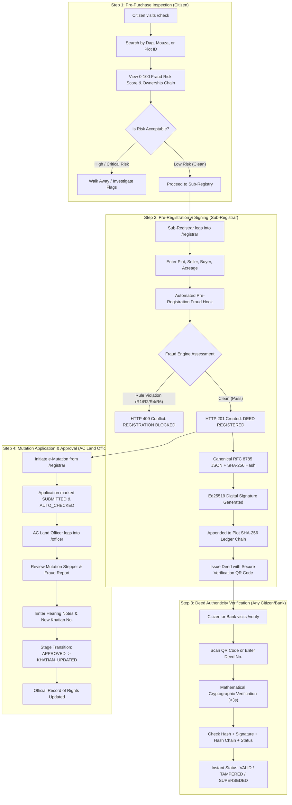

# LandShield: End-to-End System Workflow & Features Guide
**Platform Name:** LandShield (ভূমি রেকর্ড ও দলিল সুরক্ষা প্ল্যাটফর্ম)  
**Hackathon:** LandTech Innovation Hackathon 2026 (Round 1)  
**Vision:** Tamper-Evident Land Governance & Pre-Closing Fraud Prevention for Bangladesh  

---

## 1. Executive Overview & Problem Context

In Bangladesh, land administration has historically operated in two disconnected silos:
1. **Sub-Registry Offices (Ministry of Law):** Execute and register property transfer deeds under the *Registration Act of 1908*.
2. **Upazila Land Offices / AC Land (Ministry of Land):** Maintain the official Record of Rights (Khatian / Porcha) and process mutation (*Namzari*) under the *State Acquisition and Tenancy Act of 1950*.

### The Vulnerability Window (30 to 90+ Days)
Because a deed is registered at the Sub-Registry before the Upazila Land Office conducts hearings and updates the Khatian, a dangerous time gap of 30 to 90+ days opens. During this window:
- **Double Sales (দ্বৈত বিক্রয়):** Dishonest sellers sell the same land to multiple buyers before the first sale appears on official records.
- **Selling Unmutated Land (খারিজবিহীন জমি বিক্রি):** Unmutated deeds are resold without legal record of rights.
- **Stranger / Impersonator Sellers (বেনামী বিক্রেতা):** Fraudsters impersonate rightful owners.
- **Rapid Transfer Laundering:** Serial transactions take place within days to obscure fraud trails.
- **Disputed / Khas Land Resale:** Government-acquired or court-injunction plots are illegally transacted.
- **Physical Deed Forgery:** Paper deeds and ink seals are altered after registration.

**LandShield solves this crisis** by combining **Ed25519 digital signatures**, **per-plot SHA-256 blockchain-style hash chains**, **dual-view land holdings accounting**, and an **explainable 6-rule fraud detection engine** that blocks illegal sales *before closing*.

---

## 2. End-to-End System Workflow (From First Step to Last)

Below is the complete step-by-step lifecycle of how LandShield protects a land transaction from pre-purchase inspection to final mutation.



---

### Step 1: Pre-Purchase Title & Risk Check (Citizen Portal)
- **Route:** `/check` (Public access — no login required).
- **Actor:** Prospective buyer, land investor, or citizen.
- **Workflow:**
  1. The citizen searches by **Dag Number** (e.g. `101`), **Mouza** (e.g. `Mirpur`), or **Plot ID**.
  2. The system queries the backend `/api/v1/plots/{id}` and `/api/v1/risk/plot/{id}`.
  3. The citizen reviews:
     - **Circular Risk Gauge (0-100):** Visual indicator of risk level (`LOW`, `MEDIUM`, `HIGH`, `CRITICAL`).
     - **Natural Language Findings:** Plain Bangla and English explanations of any detected issues (e.g., pending court disputes, unmutated deeds, or recent rapid transfers).
     - **Chain of Custody Timeline:** Visual chronological graph of past deeds with privacy-masked owner names (`আ*** বিশ্বাস`), transfer dates, and mutation status badges.
     - **Dual-View Land Balance:** Total plot area, officially mutated record holdings, and uncommitted ledger balance.

---

### Step 2: Pre-Registration Fraud Hook & Deed Registration (Sub-Registrar Portal)
- **Route:** `/registrar` (Restricted to Sub-Registrars).
- **Actor:** Authorized Sub-Registrar (`registrar1`).
- **Workflow:**
  1. The officer logs in and selects the transaction parameters: Plot ID, Seller ID, Buyer ID, Area Sold (in decimals), Deed Type (`SALE`, `HEBA`, `MORTGAGE`, etc.), and Sub-Registry Office.
  2. **The Pre-Registration Fraud Hook (`POST /api/v1/deeds`):**
     - Before writing to the database, the backend intercepts the request and passes the proposed transfer to the **Fraud Engine**.
     - **If a Critical Rule Violation is detected (e.g. Double Sale, Stranger Seller, Excess Acreage):**
       - The transaction is **strictly blocked** with `HTTP 409 Conflict`.
       - Zero deeds are created, zero ledger entries are appended, and zero signatures are generated.
       - A high-visibility alert banner displays on the officer's screen detailing the exact rule violations and decisive reasons.
     - **If the Transfer is Clean:**
       - The deed is created with `HTTP 201 Created`.
  3. **Cryptographic Sealing:**
     - The deed payload is serialized into canonical RFC 8785 JSON.
     - The deed SHA-256 hash is computed.
     - The Sub-Registrar's secret Ed25519 key signs the hash, producing a 128-character cryptographic signature.
     - A new entry is appended to the plot's tamper-evident SHA-256 ledger chain (`prev_hash` linked).
  4. **Official QR Code Generation:**
     - The system dynamically generates an official QR code containing the tamper-proof deed verification URI.
     - The Sub-Registrar prints or downloads the QR code for stamping onto the physical paper deed.

---

### Step 3: Public Deed Authenticity & QR Verification
- **Route:** `/verify` (Public access — no login required).
- **Actor:** Citizens, commercial banks, deed writers, or verification officers.
- **Workflow:**
  1. The user points their smartphone or laptop camera at the QR code printed on the deed, or manually inputs the deed number (e.g. `MIR-2026-000001`).
  2. The system executes a 4-point cryptographic verification in under 3 seconds:
     - **Point 1 (Payload Hash Integrity):** Recomputes the SHA-256 hash of the deed contents and compares it to `deed_hash`. If a single character, date, or decimal was altered, it fails.
     - **Point 2 (Digital Signature Validity):** Validates the Ed25519 signature against the registered Sub-Registrar's public key.
     - **Point 3 (Ledger Hash Chain Continuity):** Verifies that the deed's entry in the plot's hash chain correctly references its parent block without breaks or reordering.
     - **Point 4 (Status Check):** Confirms whether the deed is `VALID`, `SUPERSEDED` by subsequent transfers, or `CANCELLED`.
  3. Returns a clean verification badge:
     - **VALID (Green):** Authentic, verified signature, continuous chain.
     - **TAMPERED (Red):** Content forged, signature invalid, or chain altered.
     - **SUPERSEDED (Amber):** Deed was genuine, but the ownership was subsequently transferred.

---

### Step 4: Electronic Mutation Workflow (AC Land Officer Portal)
- **Route:** `/officer` (Restricted to AC Land Officers).
- **Actor:** Assistant Commissioner (Land) (`officer1`).
- **Workflow:**
  1. An electronic mutation application is initiated immediately after deed registration.
  2. The application enters an automated 5-stage Finite State Machine (FSM):
     ```
     [SUBMITTED] → [AUTO_CHECKED] → [UNDER_REVIEW] → [APPROVED] → [KHATIAN_UPDATED]
                                           ↓
                                      [REJECTED]
     ```
  3. The AC Land Officer inspects the mutation application in `/officer`:
     - Reviews automated background risk checks (`AUTO_CHECKED`).
     - Inspects buyer, seller, and plot boundary details.
     - Records formal hearing notes.
     - Enters the newly issued Khatian Number.
  4. Upon transitioning to `APPROVED` and `KHATIAN_UPDATED`:
     - The plot's `current_owner_id` is officially updated in the database.
     - The buyer's *Record Holdings* officially update, closing the vulnerability window.
  5. If the application is rejected due to dispute or fraud, the deed status can be transitioned to `CANCELLED`, automatically recomputing available ledger balances.

---

### Step 5: Integrity Monitoring & Tamper Lab (Admin Portal)
- **Route:** `/admin` (Restricted to System Administrators).
- **Actor:** System Administrator (`admin1`).
- **Workflow:**
  1. **Tamper Lab Demonstration:**
     - Allows hackathon judges to simulate real-world document tampering.
     - Clicking "Tamper Deed" modifies the deed payload area (e.g., adding +1.0 decimal) directly in storage without re-signing.
     - The admin instantly clicks "Verify Deed" and observes the verification badge turn red (`TAMPERED`), proving mathematical tamper-detection.
     - Clicking "Restore Deed" reverts the payload back to authentic state.
  2. **Append-Only System Audit Log:**
     - Displays every security, authentication, deed registration, and administrative action with actor username, action type, IP/timestamp, and JSON details.

---

## 3. Core Architectural Features & Innovation Pillars

### Pillar 1: Dual-View Land Holdings Accounting
To eliminate double selling during the pre-mutation window, LandShield maintains two separate mathematical balances for every land plot:

$$\text{Ledger Holdings } (L) \quad \text{vs} \quad \text{Record Holdings } (R_r)$$

1. **Record Holdings ($R_r$):** The land acreage officially reflected in the governmental Record of Rights (Khatian / Porcha) updated via completed mutations.
2. **Ledger Holdings ($L$):** The actual uncommitted land acreage remaining after deducting all active registered deeds, even if their mutations are still pending.

> **Why this matters:** When a seller attempts to resell land before the first buyer has completed mutation, their *Record Holding* might still show ownership, but their *Ledger Holding* shows $0.00$ decimals. LandShield uses $L$ to block the double sale immediately!

---

### Pillar 2: The 6-Rule AI Fraud Detection Engine

The system evaluates transactions against 6 deterministic rules:

| Rule | Name | Severity | Decisive? | Description |
|---|---|---|---|---|
| **R1** | **Oversold / Double Sale** | CRITICAL (Weight: 60) | Yes | **OVERSOLD:** Transfer acreage exceeds total plot size.<br>**DOUBLE SALE:** Seller has Record Holding but insufficient Ledger Holding (land already committed in unmutated deed). |
| **R2** | **Seller Not Owner** | CRITICAL (Weight: 60) | Yes | Seller's holding in both Ledger and Record is less than the acreage being sold. |
| **R3** | **Missing Mutation** | MEDIUM (Weight: 25) | Yes | An active deed registered over 90 days ago has not completed mutation, leaving title in legal limbo. |
| **R4** | **Rapid Transfers** | HIGH (Weight: 35) | Yes | 3 or more land transfers detected within a 30-day sliding window on the same plot (indicative of fraud laundering). |
| **R5** | **Cryptographic Tampering** | CRITICAL (Weight: 100) | Yes | Broken plot hash chain, payload hash mismatch, or invalid Ed25519 digital signature. |
| **R6** | **Flagged / Disputed Land** | HIGH (Weight: 40) | Yes | Plot has governmental restriction flags (`khas`, `acquisition`) or active court cases (`injunction`, `dispute`). |

---

### Pillar 3: Cryptographic Integrity & Ledger Chains

- **RFC 8785 Canonical Serialization:** Guarantees consistent byte representation across languages, whitespace, and JSON key ordering.
- **SHA-256 Deed Hash:** Every deed produces a 64-character hexadecimal digest representing its exact contents.
- **Ed25519 Asymmetric Signatures:** High-speed, tamper-evident public-key cryptography (libsodium/PyNaCl). The Sub-Registrar signs with a private key; any third party verifies with the public key.
- **Per-Plot Ledger Hash Chain:** Each plot maintains its own sequential blockchain-style chain where:
  $$\text{entry\_hash} = \text{SHA256}(\text{plot\_id} \parallel \text{seq} \parallel \text{deed\_hash} \parallel \text{prev\_hash} \parallel \text{registered\_at})$$
  This makes retroactive deletion, insertion, or reordering of historical deeds mathematically impossible.

---

### Pillar 4: Privacy-Preserving Public Transparency
- **Bangla Grapheme Cluster Masking:** In compliance with data privacy principles, citizen-facing searches mask personal names (e.g. `আহমেদ কবির` becomes `আ*** ক***`).
- The masking algorithm handles complex Bengali conjunct characters (*Juktakkhor*), vowel signs (*Kar*), and dependent diacritics (*Nukta*, *Chandrabindu*) without breaking Unicode glyphs.

---

### Pillar 5: Pure Dynamic Bilingual Architecture
- **Instantaneous 100% Immersive Language Switching:** Allows toggle between conversational everyday Bangla (সহজ বাংলা) and English.
- Zero mixed language code-switching: every status badge, rule explanation, form label, and error message dynamically transitions across the entire platform.

---

## 4. The 8 Canonical Benchmark Hackathon Scenarios

The system includes 8 deterministic benchmark test scenarios seeded into the database:

| ID | Name | Plot | Seller | Buyer | Area | Expected Result | Rule Triggered |
|---|---|---|---|---|---|---|---|
| **S1** | **Double Sale Block** | Plot 1 | Person 1 | Person 99 | 30.0 dec | **409 Conflict** | **R1 (Double Sale)**: Land committed in unmutated deed. |
| **S2** | **Stranger Seller Block** | Plot 2 | Person 99 | Person 20 | 15.0 dec | **409 Conflict** | **R2 (Not Owner)**: Seller possesses zero holding. |
| **S3** | **Missing Mutation** | Plot 3 | — | — | — | **Medium Risk (25)** | **R3 (Missing Mutation)**: Deed older than 90 days unmutated. |
| **S4** | **Rapid Transfers** | Plot 4 | — | — | — | **High Risk (35)** | **R4 (Rapid Transfers)**: 3+ transfers in 30 days. |
| **S5** | **Khas / Disputed Land** | Plot 5 | — | — | — | **High Risk (40)** | **R6 (Flagged Land)**: Active court injunction or khas status. |
| **S6** | **Clean Sale** | Plot 6 | Person 16 | Person 99 | 10.0 dec | **201 Created** | **Clean deal**: Genuine owner, valid balance, no flags. |
| **S7** | **Legitimate Pending Resale** | Plot 7 | Person 17 | Person 18 | 20.0 dec | **Low Risk** | Resale within legal 90-day grace period. |
| **S8** | **Partial Acreage Sales** | Plot 8 | Person 20 | Person 21 | 10.0 dec | **Low Risk** | Legitimate partial sales with remaining balance. |

---

## 5. System Roles & Access Matrix

| Role | Default Username | Default Password | Accessible Portals & Capabilities |
|---|---|---|---|
| **Citizen** | *(Public)* | *(No login)* | `/check` (Pre-Purchase Check), `/verify` (QR Scanner & Verification). |
| **Sub-Registrar** | `registrar1` | `RegistrarPass123!` | `/registrar` (Deed Creation, Pre-Registration Fraud Hook, QR Generator, Mutation Starter). |
| **AC Land Officer** | `officer1` | `OfficerPass123!` | `/officer` (Mutation Review Stepper, Hearing Notes, Khatian Updates, Risk Alerts). |
| **System Admin** | `admin1` | `AdminPass123!` | `/admin` (Tamper Lab Simulation, Cryptographic Forgery Test, Append-Only Audit Trail). |

---

## 6. How to Run & Verify on Localhost

### 1. Start the Backend API (FastAPI)
```bash
cd backend
.\.venv\Scripts\python.exe -m uvicorn app.main:app --host 127.0.0.1 --port 8000
```
- API Health Check: `http://127.0.0.1:8000/health` → `{"status": "ok"}`
- Interactive OpenAPI Docs: `http://127.0.0.1:8000/docs`

### 2. Start the Frontend (Next.js 16)
```bash
cd frontend
npm start
# (or npm run dev)
```
- Web Application: `http://localhost:3000`

### 3. Reset Demo Seed Data Anytime
If test scenarios are exhausted after multiple demo runs, restore pristine state in 2 seconds:
```bash
cd backend
$env:PYTHONPATH = "."; .\.venv\Scripts\python.exe scripts/seed.py --reset
```
